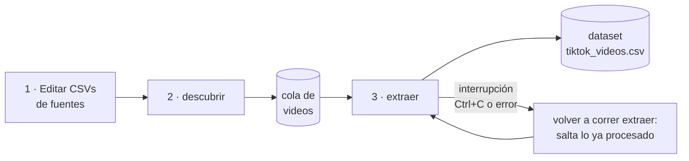

# Guía de uso — Scraper de TikTok

Guía paso a paso para instalar, configurar y operar el scraper, pensada para
que cualquier persona del equipo (o tú en una máquina nueva) pueda usarlo sin
conocer el código. Para la arquitectura interna ver el [README](README.md).

## 1. Qué hace

Recolecta videos de TikTok desde dos tipos de fuente:

- **Cuentas específicas** (perfiles de candidatos, políticos, medios…)
- **Hashtags / palabras clave** (requiere un paso extra, ver §5)

Y por cada video obtiene:

| Dato | Detalle |
|---|---|
| Metadata | autor, descripción, hashtags, fecha, duración, música |
| Métricas | vistas, likes, comentarios, compartidos, guardados |
| Transcripción | subtítulos de TikTok si existen; si no, Whisper sobre el audio |
| Archivo | el `.mp4` descargado a disco (opcional) |

Todo queda en un CSV con una fila por video, listo para pandas.

## 2. Requisitos

- macOS, Linux o Windows 10/11
- **Python 3.11 a 3.14** (3.15 aún no: a nov 2026 falta el wheel de
  `onnxruntime`, que necesita la transcripción; con `--sin-transcripcion`
  podría correr, pero mejor quedarse en 3.13/3.14)
- **ffmpeg** (transcripción y unión de video+audio)
- Firefox con sesión abierta en tiktok.com (recomendado: el scraper reusa sus
  cookies para peticiones autenticadas)

## 3. Instalación desde cero

El scraper se ejecuta como módulo Python, así que clona el repo con el nombre
del paquete (`tiktok_scraper`, con guion bajo) y ejecuta siempre **desde la
carpeta que lo contiene**.

### macOS / Linux

```bash
# 1. Clonar el repo con el nombre del paquete
git clone https://github.com/manuelcastiblan/tiktok-scraper.git tiktok_scraper

# 2. Crear entorno virtual (fuera de carpetas sincronizadas con iCloud/Drive,
#    ver §9 "Problemas conocidos")
python3.13 -m venv ~/venvs/tiktok
~/venvs/tiktok/bin/pip install --upgrade pip
~/venvs/tiktok/bin/pip install -r tiktok_scraper/requirements.txt curl_cffi

# 3. ffmpeg
brew install ffmpeg          # macOS
# sudo apt install ffmpeg    # Linux

# 4. Navegador de Playwright (SOLO si usarás hashtags)
~/venvs/tiktok/bin/playwright install webkit
```

### Windows 10/11 (PowerShell)

Instala antes [Python 3.13 de python.org](https://www.python.org/downloads/)
(marcando "py launcher") y [Git](https://git-scm.com/download/win).

```powershell
# 1. Clonar el repo con el nombre del paquete
git clone https://github.com/manuelcastiblan/tiktok-scraper.git tiktok_scraper

# 2. Crear entorno virtual (fuera de carpetas sincronizadas con OneDrive,
#    ver §9 "Problemas conocidos")
py -3.13 -m venv "$HOME\venvs\tiktok"
& "$HOME\venvs\tiktok\Scripts\pip" install --upgrade pip
& "$HOME\venvs\tiktok\Scripts\pip" install -r tiktok_scraper\requirements.txt curl_cffi

# 3. ffmpeg (abre una terminal NUEVA después, para que el PATH se refresque)
winget install Gyan.FFmpeg

# 4. Hashtags: en Windows se usa el Chrome instalado (no hay que descargar
#    navegador). Guarda la sesión una vez con el comando `sesion` (ver §5).
```

> **Equivalencia de rutas:** donde esta guía diga `~/venvs/tiktok/bin/python`,
> en Windows usa `& "$HOME\venvs\tiktok\Scripts\python"`.

> **Nota:** `curl_cffi` no es opcional. Sin él, yt-dlp no puede imitar un
> navegador real y TikTok rechaza muchas peticiones.

## 4. Configurar las fuentes

Edita los dos CSV de entrada:

**`data/cuentas.csv`** — una cuenta por fila, sin `@`:

```csv
usuario
gustavopetro
eltiempo
```

**`data/hashtags.csv`** — un hashtag por fila, sin `#`:

```csv
hashtag
elecciones2026
politica
```

Si una fuente no te interesa, deja el archivo solo con el encabezado.

## 5. El msToken (solo para hashtags)

La búsqueda por hashtag usa la API interna de TikTok, que exige un token de
sesión llamado `msToken`. **Sin él, TikTok devuelve vacío siempre** (está
verificado: no hay configuración de navegador que lo evite).

Cómo obtenerlo:

1. Abre https://www.tiktok.com en Firefox, logueado, y navega un poco.
2. Herramientas del desarrollador (`⌘⌥I` en Mac, `F12` en Windows/Linux) →
   pestaña **Almacenamiento** → **Cookies** → `https://www.tiktok.com`.
3. Copia el valor de la cookie `msToken`.
4. Expórtalo en la terminal antes de correr:

```bash
# macOS / Linux
export TT_MS_TOKEN="valor_copiado_aqui"
```

```powershell
# Windows (PowerShell)
$env:TT_MS_TOKEN = "valor_copiado_aqui"
```

### Si TikTok pide CAPTCHA: comando `sesion`

A veces el token no basta: TikTok le muestra un CAPTCHA (puzle deslizante) al
navegador automatizado y, hasta que alguien lo resuelve, la lista de videos
llega vacía (`TikTok returned an empty response`). El scraper no resuelve
CAPTCHAs; lo haces tú una vez:

```bash
python -m tiktok_scraper.run sesion
```

Se abre una ventana del navegador en la página de un hashtag. Resuelve el
puzle si aparece (y entra a tu cuenta si quieres), comprueba que aparecen los
videos y **cierra la ventana**. La sesión queda guardada en
`perfil_navegador/`.

Mientras esa carpeta exista, `descubrir` cambia de método para los hashtags:
abre la página pública del hashtag con esa sesión (en segundo plano) y lee la
lista de videos que carga la propia página al hacer scroll. Así **no hace
falta `TT_MS_TOKEN`** ni depende de TikTokApi. Verificado en Windows
(nov 2026): 40 videos por hashtag sin token. Si los hashtags vuelven a dar
vacío, repite `sesion`.

En **Windows** se usa el Chrome instalado (el webkit de Playwright no logra
cargar el CAPTCHA allí: muestra `networkErrorText`). Se cambia con
`TT_TIKTOKAPI_BROWSER` / `TT_TIKTOKAPI_CANAL` (§10). Esa carpeta contiene tus cookies: no la compartas ni la subas
(ya está en `.gitignore`). Para dejar de usarla, bórrala.

⚠️ El token **expira** (horas o pocos días). Si los hashtags vuelven a dar
vacío, renueva el token. Las cuentas NO necesitan este paso.

## 6. Uso

El flujo tiene dos fases, pensadas para poder interrumpir y reanudar:



```bash
# Fase 1 — DESCUBRIR: llena la cola con los videos de cada fuente
python -m tiktok_scraper.run descubrir --max-por-fuente 50

# Fase 2 — EXTRAER: procesa lo pendiente de la cola
python -m tiktok_scraper.run extraer

# O ambas de una:
python -m tiktok_scraper.run all --max-por-fuente 50
```

(usando siempre el python del venv: `~/venvs/tiktok/bin/python` en macOS/Linux,
`& "$HOME\venvs\tiktok\Scripts\python"` en Windows)

Flags de `extraer` / `all`:

| Flag | Efecto |
|---|---|
| `--limite N` | Procesar máximo N videos en esta corrida |
| `--sin-video` | No descargar el `.mp4` (solo metadata + transcripción) |
| `--sin-transcripcion` | No transcribir |
| `--modelo-whisper X` | `tiny`/`base`/`small`/`medium`/`large-v3` (default `small`) |

**Primera corrida:** empieza con `--max-por-fuente 10 --limite 5` para validar
que todo funciona antes de lanzar una recolección grande.

### Reanudación

Puedes cortar el proceso cuando quieras (`Ctrl+C`): el progreso se guarda cada
5 videos y, al volver a correr `extraer`, salta automáticamente todo video ya
presente en el dataset. Volver a `descubrir` tampoco duplica: la cola se
deduplica por `video_id`.

## 7. Salida

- **`data/tiktok_videos.csv`** — el dataset, una fila por video:
  `video_id, url, autor, autor_nombre, descripcion, hashtags, fecha,
  duracion_seg, vistas, likes, comentarios, compartidos, guardados, musica,
  transcripcion, fuente_transcripcion, ruta_video, resolucion, fuente_tipo,
  fuente_valor, extraido_en`
  - `hashtags` van separados por `|`
  - `fuente_transcripcion`: `subtitulos` (captions de TikTok), `whisper` o `none`
  - `fuente_tipo`/`fuente_valor`: de qué cuenta o hashtag salió el video
- **`videos/`** — los `.mp4`, nombrados por `video_id`
- **`subtitulos/`** — los `.vtt` cuando TikTok los ofrece
- **`data/cola_videos.csv`** — la cola interna (no editar a mano)

## 8. Transcripción: qué modelo usar

| Modelo | Velocidad | Calidad | Cuándo |
|---|---|---|---|
| `tiny` | ~10 s/video | Regular, errores frecuentes | Pruebas rápidas |
| `small` (default) | ~1 min/video | Buena | Recolección general |
| `medium` | ~3 min/video | Muy buena | Análisis de discurso fino |

Por defecto todo corre en CPU (tiempos de la tabla). La primera vez que uses un modelo se descarga (~75 MB a
~1.5 GB según tamaño). Si el video trae subtítulos de TikTok, se usan esos y
Whisper no corre.

💡 **GPU NVIDIA (Windows/Linux):** instala las librerías CUDA en el venv y
activa `cuda`; el scraper las encuentra solo y usa `float16`:

```powershell
& "$HOME\venvs\tiktok\Scripts\pip" install nvidia-cublas-cu12 nvidia-cudnn-cu12
$env:TT_WHISPER_DEVICE = "cuda"
```

Con GPU conviene subir de modelo: en una RTX 5080 (nov 2026), un video de 76 s
tomó ~4 s con `medium` o `large-v3`, frente a ~16 s con `small` en CPU. Si
aparece `Library cublas64_12.dll is not found`, faltan esos dos paquetes.

💡 En Macs con Apple Silicon y ctranslate2 ≥ 4.9 existe un backend
experimental ~2x más rápido: pruébalo con `TT_WHISPER_DEVICE=mps` (si da
problemas, vuelve al default `cpu`).

## 9. Problemas conocidos y soluciones

| Síntoma | Causa probable | Solución |
|---|---|---|
| Fallan muchas extracciones de golpe | TikTok cambió su web | `pip install -U yt-dlp` (primera medida SIEMPRE) |
| Hashtags devuelven 0 videos | msToken ausente o expirado, o TikTok pide CAPTCHA | Renovar `TT_MS_TOKEN`; si sigue vacío, correr `sesion` y resolver el CAPTCHA (§5) |
| Cuentas con `Unable to extract secondary user ID` | TikTok sirve una página-desafío si yt-dlp no imita un navegador; o la cuenta no existe / es privada | Comprobar que `curl_cffi` está instalado y que `TT_IMPERSONAR` no está vacío (default `chrome`); verificar la cuenta en el navegador |
| `❌ yt-dlp falló … No video formats found!` en un video | Normalmente es una publicación de fotos (carrusel), no un video | Ninguna: se omite. Seguirá apareciendo como pendiente en cada corrida |
| Las cookies no parecen surtir efecto | Hay varios perfiles de Firefox y yt-dlp toma el usado más recientemente | Fijar `TT_COOKIES_PERFIL` con la carpeta del perfil logueado (ver `about:profiles`) |
| `Library cublas64_12.dll is not found` | `TT_WHISPER_DEVICE=cuda` sin las librerías CUDA | `pip install nvidia-cublas-cu12 nvidia-cudnn-cu12` (§8) |
| Una cuenta devuelve 0–1 videos sin error | Cuenta privada, inexistente o casi sin contenido | Verificar la cuenta en el navegador |
| `impersonation` warning | Falta `curl_cffi` | `pip install curl_cffi` |
| Error de ffmpeg al transcribir | ffmpeg no instalado | `brew install ffmpeg` |
| `brew: command not found` (Mac) | Homebrew no instalado, o instalado pero fuera del PATH (típico en Macs M1/M2/M3, donde vive en `/opt/homebrew`) | Si `ls /opt/homebrew/bin/brew` existe, conectarlo: `echo 'eval "$(/opt/homebrew/bin/brew shellenv)"' >> ~/.zprofile` y abrir una Terminal nueva. Si no existe, instalarlo con el comando oficial de [brew.sh](https://brew.sh) y al final pegar los dos comandos que el instalador muestra en "Next steps" |
| `pkg-config is required for building PyAV` al instalar | pip no encontró wheel de `av` para ese entorno e intenta compilarlo. Casi siempre: venv creado con Python ≤ 3.10, pip desactualizado, o Mac Apple Silicon con macOS 12/13 (el wheel arm64 pide macOS ≥ 14) | Verificar `python --version` (debe ser 3.11–3.14) y crear el venv con ese Python exacto; actualizar pip dentro del venv (`pip install -U pip`) ANTES de instalar; en macOS viejo, actualizar el sistema o `brew install pkg-config ffmpeg` para permitir la compilación |
| El primer import tarda ~1 min | venv dentro de carpeta sincronizada (iCloud en Mac, OneDrive en Windows) que desaloja archivos a la nube | Mover el venv fuera (p. ej. `~/venvs/`); en Mac sirve el sufijo `.nosync`, en Windows marcar la carpeta como "Conservar siempre en este dispositivo". No es un entorno roto: el segundo arranque es rápido |
| Emojis como `?` o `UnicodeEncodeError` (Windows) | Consola con codificación antigua (cp1252/cp850) | Usar Windows Terminal o PowerShell 7; el scraper además degrada los símbolos solo en vez de fallar |
| Bloqueos / errores 403 repetidos | Demasiado volumen muy rápido | Subir `TT_ESPERA_MIN/MAX`, bajar volumen, considerar proxy |

## 10. Configuración avanzada (variables de entorno)

Todas opcionales; se anteponen al comando o se exportan:

| Variable | Default | Qué hace |
|---|---|---|
| `TT_MAX_POR_FUENTE` | 100 | Videos por cuenta/hashtag |
| `TT_MS_TOKEN` | — | Token para hashtags (§5) |
| `TT_COOKIES_NAVEGADOR` | firefox | De qué navegador toma cookies yt-dlp (`firefox`/`chrome`/`safari`/vacío) |
| `TT_COOKIES_PERFIL` | — | Perfil del navegador; en Firefox, el nombre de la carpeta del perfil (p. ej. `abcd1234.default-release`) o su ruta. Vacío = el más reciente |
| `TT_IMPERSONAR` | chrome | Navegador que imita yt-dlp vía `curl_cffi`; sin esto las cuentas devuelven 0 videos. Vacío = desactivar |
| `TT_WHISPER_DEVICE` / `TT_WHISPER_COMPUTE` | cpu / int8 | `cuda` para GPU NVIDIA (entonces el cómputo por defecto es `float16`) |
| `TT_DESCARGAR_VIDEO` | 1 | `0` = no bajar `.mp4` |
| `TT_TRANSCRIBIR` | 1 | `0` = no transcribir |
| `TT_MODELO_WHISPER` | small | Modelo de Whisper |
| `TT_IDIOMA_WHISPER` | es | Idioma esperado (vacío = autodetectar) |
| `TT_ESPERA_MIN` / `TT_ESPERA_MAX` | 3 / 7 | Delay aleatorio entre videos (seg) |
| `TT_GUARDAR_CADA` | 5 | Frecuencia del guardado incremental |
| `TT_HEADLESS` | 1 | `0` = navegador visible en hashtags |
| `TT_TIKTOKAPI_BROWSER` | webkit (Windows: chromium) | Motor de Playwright para hashtags |
| `TT_TIKTOKAPI_CANAL` | — (Windows: chrome) | Navegador instalado a usar con `chromium`: `chrome` o `msedge` |
| `TT_PERFIL_DIR` | ./perfil_navegador | Perfil persistente que crea `sesion` (§5) |
| `TT_DATA_DIR`, `TT_VIDEO_DIR`, `TT_SUB_DIR` | ./data, ./videos, ./subtitulos | Rutas de salida |

Ejemplo — recolección grande, sin videos, transcripción fina, más lenta y cuidadosa:

```bash
# macOS / Linux
TT_ESPERA_MIN=5 TT_ESPERA_MAX=12 python -m tiktok_scraper.run all \
    --max-por-fuente 200 --sin-video --modelo-whisper medium
```

```powershell
# Windows (PowerShell)
$env:TT_ESPERA_MIN = "5"; $env:TT_ESPERA_MAX = "12"
& "$HOME\venvs\tiktok\Scripts\python" -m tiktok_scraper.run all `
    --max-por-fuente 200 --sin-video --modelo-whisper medium
```

## 11. Uso responsable

Este scraper existe para **investigación académica**. Al usarlo:

- Recolecta solo lo necesario para tu pregunta de investigación (minimización).
- Anonimiza o seudonimiza usuarios al publicar resultados, salvo figuras
  públicas en su rol público.
- El scraping automatizado va contra los Términos de Servicio de TikTok;
  evalúa ese riesgo con tu institución. Para proyectos que requieran acceso
  sancionado, considera la TikTok Research API.
- No redistribuyas los videos descargados: son contenido de terceros. El
  `.gitignore` del repo ya excluye `videos/` y los datasets por esta razón.

## 12. Mantenimiento

- **Antes de cada campaña de recolección:** `pip install -U yt-dlp` en el venv.
- Si tras actualizar yt-dlp algo sigue roto, revisar los issues de
  [yt-dlp](https://github.com/yt-dlp/yt-dlp/issues) y
  [TikTokApi](https://github.com/davidteather/TikTok-Api/issues) — cuando
  TikTok cambia algo grande, ahí aparece primero.
