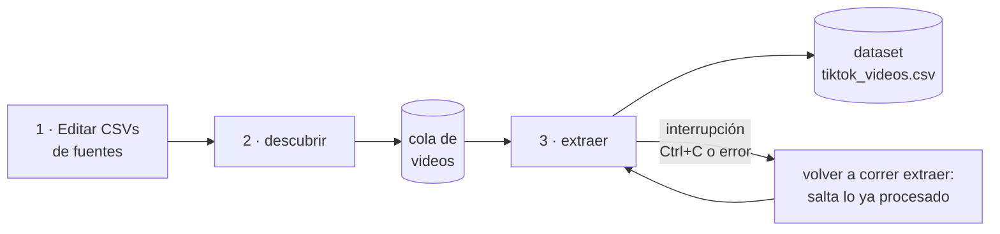

# Guía de uso — Scraper de TikTok

Guía paso a paso para instalar, configurar y operar el scraper, pensada para
que cualquier persona del equipo (o tú en una máquina nueva) pueda usarlo sin
conocer el código. Para la arquitectura interna ver el [README](README.md).

## 1. Qué hace

Recolecta videos de TikTok desde dos tipos de fuente:

- **Cuentas específicas** (perfiles de candidatos, políticos, medios…)
- **Hashtags / palabras clave** (requiere un paso extra, ver §5)

Y por cada video obtiene:

| Dato | Detalle |
|---|---|
| Metadata | autor, descripción, hashtags, fecha, duración, música |
| Métricas | vistas, likes, comentarios, compartidos, guardados |
| Transcripción | subtítulos de TikTok si existen; si no, Whisper sobre el audio |
| Archivo | el `.mp4` descargado a disco (opcional) |

Todo queda en un CSV con una fila por video, listo para pandas.

## 2. Requisitos

- macOS o Linux
- **Python 3.11 a 3.13** (3.14 aún no tiene wheels para todas las dependencias)
- **ffmpeg** (transcripción y unión de video+audio)
- Firefox con sesión abierta en tiktok.com (recomendado: el scraper reusa sus
  cookies para peticiones autenticadas)

## 3. Instalación desde cero

```bash
# 1. Clonar el repo
git clone https://github.com/manuelcastiblan/tiktok-scraper.git
cd tiktok-scraper

# 2. Crear entorno virtual (fuera de carpetas sincronizadas con iCloud/Drive,
#    ver §9 "Problemas conocidos")
python3.13 -m venv ~/venvs/tiktok
~/venvs/tiktok/bin/pip install -r requirements.txt curl_cffi

# 3. ffmpeg
brew install ffmpeg          # macOS
# sudo apt install ffmpeg    # Linux

# 4. Navegador de Playwright (SOLO si usarás hashtags)
~/venvs/tiktok/bin/playwright install webkit
```

> **Nota:** `curl_cffi` no es opcional. Sin él, yt-dlp no puede imitar un
> navegador real y TikTok rechaza muchas peticiones.

El scraper se ejecuta como módulo **desde la carpeta que contiene el paquete**
(si clonaste como `tiktok-scraper`, renombra o ejecuta desde el padre con el
nombre `tiktok_scraper`; lo más simple es clonar así):

```bash
git clone https://github.com/manuelcastiblan/tiktok-scraper.git tiktok_scraper
```

## 4. Configurar las fuentes

Edita los dos CSV de entrada:

**`data/cuentas.csv`** — una cuenta por fila, sin `@`:

```csv
usuario
gustavopetro
eltiempo
```

**`data/hashtags.csv`** — un hashtag por fila, sin `#`:

```csv
hashtag
elecciones2026
politica
```

Si una fuente no te interesa, deja el archivo solo con el encabezado.

## 5. El msToken (solo para hashtags)

La búsqueda por hashtag usa la API interna de TikTok, que exige un token de
sesión llamado `msToken`. **Sin él, TikTok devuelve vacío siempre** (está
verificado: no hay configuración de navegador que lo evite).

Cómo obtenerlo:

1. Abre https://www.tiktok.com en Firefox, logueado, y navega un poco.
2. Herramientas del desarrollador (`⌘⌥I`) → pestaña **Almacenamiento** →
   **Cookies** → `https://www.tiktok.com`.
3. Copia el valor de la cookie `msToken`.
4. Expórtalo en la terminal antes de correr:

```bash
export TT_MS_TOKEN="valor_copiado_aqui"
```

⚠️ El token **expira** (horas o pocos días). Si los hashtags vuelven a dar
vacío, renueva el token. Las cuentas NO necesitan este paso.

## 6. Uso

El flujo tiene dos fases, pensadas para poder interrumpir y reanudar:



```bash
# Fase 1 — DESCUBRIR: llena la cola con los videos de cada fuente
python -m tiktok_scraper.run descubrir --max-por-fuente 50

# Fase 2 — EXTRAER: procesa lo pendiente de la cola
python -m tiktok_scraper.run extraer

# O ambas de una:
python -m tiktok_scraper.run all --max-por-fuente 50
```

(usando siempre el python del venv: `~/venvs/tiktok/bin/python`)

Flags de `extraer` / `all`:

| Flag | Efecto |
|---|---|
| `--limite N` | Procesar máximo N videos en esta corrida |
| `--sin-video` | No descargar el `.mp4` (solo metadata + transcripción) |
| `--sin-transcripcion` | No transcribir |
| `--modelo-whisper X` | `tiny`/`base`/`small`/`medium`/`large-v3` (default `small`) |

**Primera corrida:** empieza con `--max-por-fuente 10 --limite 5` para validar
que todo funciona antes de lanzar una recolección grande.

### Reanudación

Puedes cortar el proceso cuando quieras (`Ctrl+C`): el progreso se guarda cada
5 videos y, al volver a correr `extraer`, salta automáticamente todo video ya
presente en el dataset. Volver a `descubrir` tampoco duplica: la cola se
deduplica por `video_id`.

## 7. Salida

- **`data/tiktok_videos.csv`** — el dataset, una fila por video:
  `video_id, url, autor, autor_nombre, descripcion, hashtags, fecha,
  duracion_seg, vistas, likes, comentarios, compartidos, guardados, musica,
  transcripcion, fuente_transcripcion, ruta_video, resolucion, fuente_tipo,
  fuente_valor, extraido_en`
  - `hashtags` van separados por `|`
  - `fuente_transcripcion`: `subtitulos` (captions de TikTok), `whisper` o `none`
  - `fuente_tipo`/`fuente_valor`: de qué cuenta o hashtag salió el video
- **`videos/`** — los `.mp4`, nombrados por `video_id`
- **`subtitulos/`** — los `.vtt` cuando TikTok los ofrece
- **`data/cola_videos.csv`** — la cola interna (no editar a mano)

## 8. Transcripción: qué modelo usar

| Modelo | Velocidad | Calidad | Cuándo |
|---|---|---|---|
| `tiny` | ~10 s/video | Regular, errores frecuentes | Pruebas rápidas |
| `small` (default) | ~1 min/video | Buena | Recolección general |
| `medium` | ~3 min/video | Muy buena | Análisis de discurso fino |

Todo corre en CPU. La primera vez que uses un modelo se descarga (~75 MB a
~1.5 GB según tamaño). Si el video trae subtítulos de TikTok, se usan esos y
Whisper no corre.

## 9. Problemas conocidos y soluciones

| Síntoma | Causa probable | Solución |
|---|---|---|
| Fallan muchas extracciones de golpe | TikTok cambió su web | `pip install -U yt-dlp` (primera medida SIEMPRE) |
| Hashtags devuelven 0 videos | msToken ausente o expirado | Renovar `TT_MS_TOKEN` (§5) |
| Una cuenta devuelve 0–1 videos sin error | Cuenta privada, inexistente o casi sin contenido | Verificar la cuenta en el navegador |
| `impersonation` warning | Falta `curl_cffi` | `pip install curl_cffi` |
| Error de ffmpeg al transcribir | ffmpeg no instalado | `brew install ffmpeg` |
| El primer import tarda ~1 min | venv dentro de carpeta sincronizada con iCloud/Drive que desaloja archivos | Mover el venv fuera (p. ej. `~/venvs/`) o usar sufijo `.nosync`; no es un entorno roto, el segundo arranque es rápido |
| Bloqueos / errores 403 repetidos | Demasiado volumen muy rápido | Subir `TT_ESPERA_MIN/MAX`, bajar volumen, considerar proxy |

## 10. Configuración avanzada (variables de entorno)

Todas opcionales; se anteponen al comando o se exportan:

| Variable | Default | Qué hace |
|---|---|---|
| `TT_MAX_POR_FUENTE` | 100 | Videos por cuenta/hashtag |
| `TT_MS_TOKEN` | — | Token para hashtags (§5) |
| `TT_COOKIES_NAVEGADOR` | firefox | De qué navegador toma cookies yt-dlp (`firefox`/`chrome`/`safari`/vacío) |
| `TT_DESCARGAR_VIDEO` | 1 | `0` = no bajar `.mp4` |
| `TT_TRANSCRIBIR` | 1 | `0` = no transcribir |
| `TT_MODELO_WHISPER` | small | Modelo de Whisper |
| `TT_IDIOMA_WHISPER` | es | Idioma esperado (vacío = autodetectar) |
| `TT_ESPERA_MIN` / `TT_ESPERA_MAX` | 3 / 7 | Delay aleatorio entre videos (seg) |
| `TT_GUARDAR_CADA` | 5 | Frecuencia del guardado incremental |
| `TT_HEADLESS` | 1 | `0` = navegador visible en hashtags |
| `TT_DATA_DIR`, `TT_VIDEO_DIR`, `TT_SUB_DIR` | ./data, ./videos, ./subtitulos | Rutas de salida |

Ejemplo — recolección grande, sin videos, transcripción fina, más lenta y cuidadosa:

```bash
TT_ESPERA_MIN=5 TT_ESPERA_MAX=12 python -m tiktok_scraper.run all \
    --max-por-fuente 200 --sin-video --modelo-whisper medium
```

## 11. Uso responsable

Este scraper existe para **investigación académica**. Al usarlo:

- Recolecta solo lo necesario para tu pregunta de investigación (minimización).
- Anonimiza o seudonimiza usuarios al publicar resultados, salvo figuras
  públicas en su rol público.
- El scraping automatizado va contra los Términos de Servicio de TikTok;
  evalúa ese riesgo con tu institución. Para proyectos que requieran acceso
  sancionado, considera la TikTok Research API.
- No redistribuyas los videos descargados: son contenido de terceros. El
  `.gitignore` del repo ya excluye `videos/` y los datasets por esta razón.

## 12. Mantenimiento

- **Antes de cada campaña de recolección:** `pip install -U yt-dlp` en el venv.
- Si tras actualizar yt-dlp algo sigue roto, revisar los issues de
  [yt-dlp](https://github.com/yt-dlp/yt-dlp/issues) y
  [TikTokApi](https://github.com/davidteather/TikTok-Api/issues) — cuando
  TikTok cambia algo grande, ahí aparece primero.
