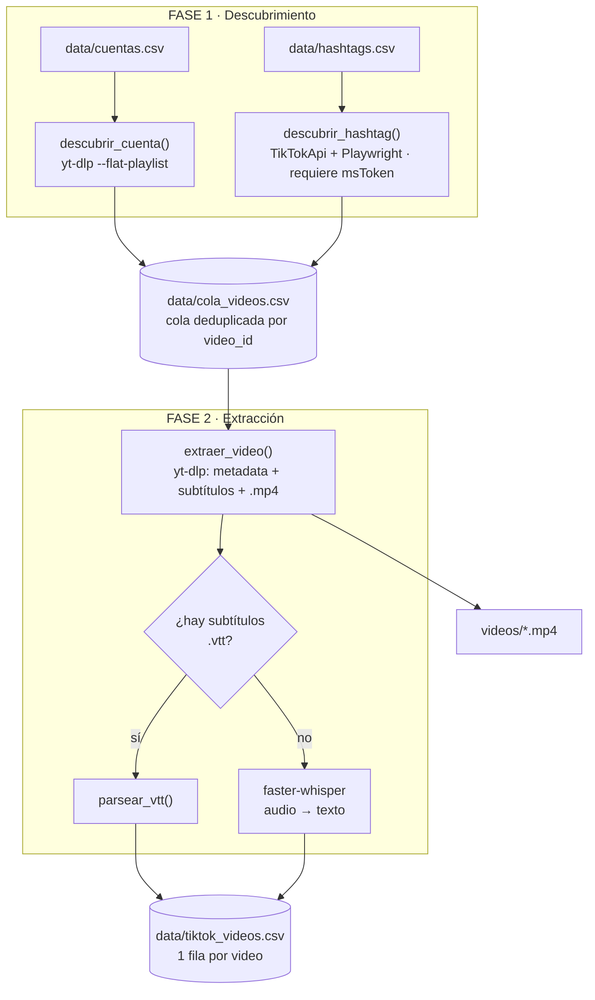

# Scraper de TikTok — FLACSO

Scraper modular para investigación en ciencias sociales. Recolecta videos de
**cuentas específicas** y de **hashtags/palabras clave**, y por cada video obtiene
**metadata + texto**, **transcripción del audio** y el **archivo de video (.mp4)**.

Sigue el mismo patrón de tus scrapers de X/LinkedIn: entradas en CSV, guardado
incremental y reanudable, delays aleatorios y reuso de cookies del navegador.

## Arquitectura



Separar **descubrimiento** de **extracción** permite reanudar sin repetir: la
extracción salta cualquier `video_id` que ya esté en `tiktok_videos.csv`.

## Instalación y uso

**👉 Ver la [GUÍA completa](GUIA.md)**: instalación desde cero, configuración,
obtención del msToken, flags, solución de problemas y uso responsable.

Resumen mínimo:

```bash
python3.13 -m venv ~/venvs/tiktok
~/venvs/tiktok/bin/pip install -r requirements.txt curl_cffi
brew install ffmpeg
~/venvs/tiktok/bin/playwright install webkit   # solo para hashtags
```

(`curl_cffi` permite a yt-dlp imitar un navegador real; sin él TikTok
rechaza muchas peticiones.)

> Nota local (máquina original del proyecto): el venv ya existe como
> `venv_tiktok/` en `~/Documents/flacso`, junto al paquete.

## Configuración

Edita las entradas:
- `data/cuentas.csv`  → una cuenta por fila (columna `usuario`, sin `@`).
- `data/hashtags.csv` → un hashtag/término por fila (columna `hashtag`, sin `#`).

Para la búsqueda por **hashtags** el `msToken` es **obligatorio** (verificado:
sin él TikTok detecta el bot y devuelve vacío, incluso con webkit o ventana
visible). Se obtiene así:

1. Abre https://www.tiktok.com en Firefox y navega un poco (logueado mejor).
2. Herramientas del desarrollador (⌘⌥I) → pestaña **Almacenamiento** →
   **Cookies** → `https://www.tiktok.com` → copia el valor de `msToken`.
3. Exporta antes de correr (el token expira, hay que renovarlo cada tanto):

```bash
export TT_MS_TOKEN="pega_aqui_el_valor_de_la_cookie_msToken"
```

Otras variables útiles (todas opcionales, ver `config.py`):

| Variable | Default | Qué hace |
|---|---|---|
| `TT_MAX_POR_FUENTE` | 100 | Videos por cuenta/hashtag |
| `TT_COOKIES_NAVEGADOR` | firefox | Navegador del que yt-dlp toma cookies |
| `TT_MODELO_WHISPER` | small | Modelo de transcripción |
| `TT_IDIOMA_WHISPER` | es | Idioma esperado del audio |
| `TT_ESPERA_MIN/MAX` | 3 / 7 | Delay aleatorio entre videos (seg) |

## Uso

```bash
# 1) Descubrir y llenar la cola
python -m tiktok_scraper.run descubrir --max-por-fuente 100

# 2) Extraer todo lo pendiente (metadata + transcripción + video)
python -m tiktok_scraper.run extraer

# Todo de una, con límite de prueba de 10 videos:
python -m tiktok_scraper.run all --max-por-fuente 30 --limite 10

# Solo metadata + transcripción, sin descargar el .mp4:
python -m tiktok_scraper.run extraer --sin-video
```

## Salida (`data/tiktok_videos.csv`)

Una fila por video con: `video_id, url, autor, autor_nombre, descripcion,
hashtags, fecha, duracion_seg, vistas, likes, comentarios, compartidos,
guardados, musica, transcripcion, fuente_transcripcion, ruta_video, resolucion,
fuente_tipo, fuente_valor, extraido_en`.

Esto conecta directo con tu pipeline de análisis de texto y de redes
(hashtags/menciones) que ya usas para X.

## Notas y límites

- **TikTok es más agresivo que X** con la detección de bots. El descubrimiento
  por hashtag (TikTokApi/Playwright) es lo más frágil; si falla, revisa el
  `msToken` y considera bajar el volumen o usar un proxy.
- Respeta los Términos de Servicio de TikTok y la normativa de datos personales
  aplicable a tu investigación (uso académico, minimización, anonimización de
  usuarios cuando corresponda).
- Alternativa robusta y de pago si el volumen crece o el mantenimiento cansa:
  actors de Apify para TikTok (hashtags/cuentas/comentarios).
- Si más adelante quieres **comentarios**, se agrega un módulo `comments.py`
  usando `TikTokApi.video(url).comments()`; el diseño ya lo permite.

## Licencia

[MIT](LICENSE) © 2026 Manuel Elkin Castiblanco Briceño
